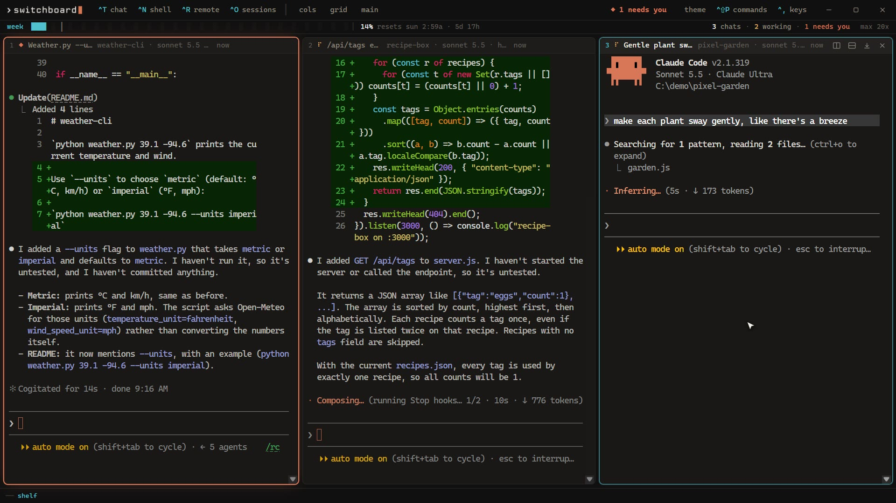
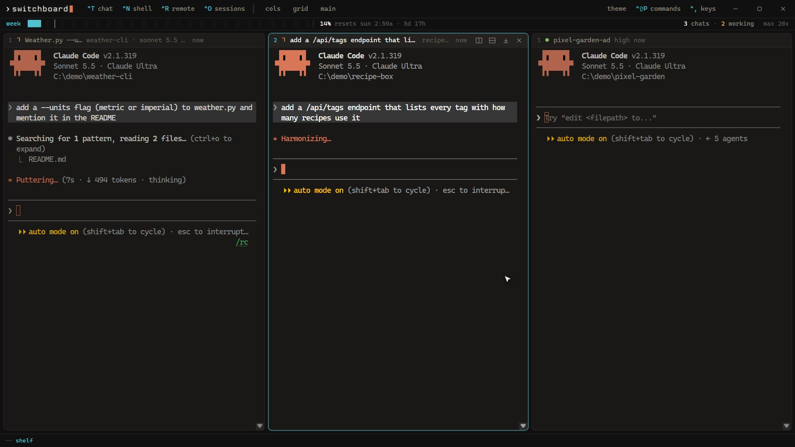
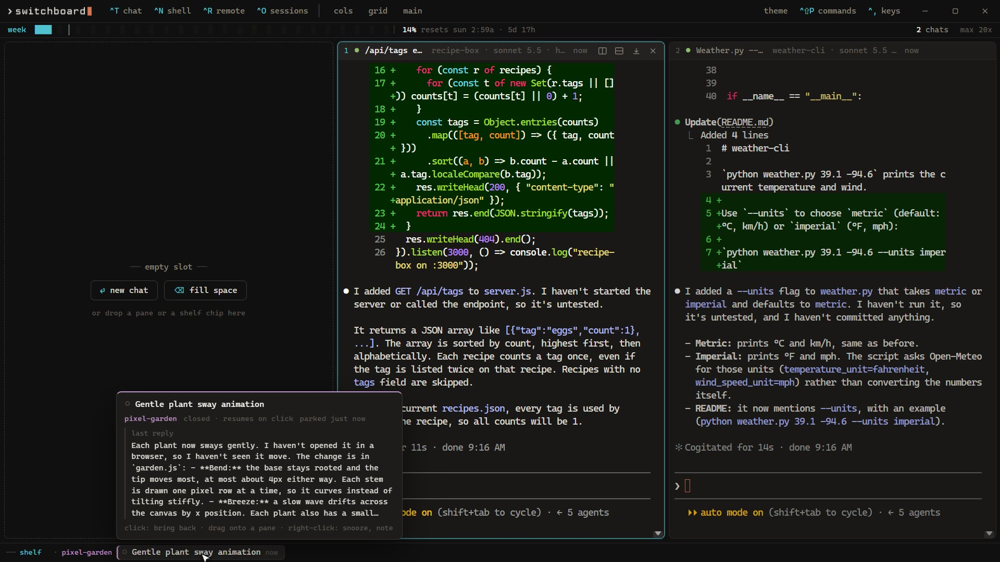
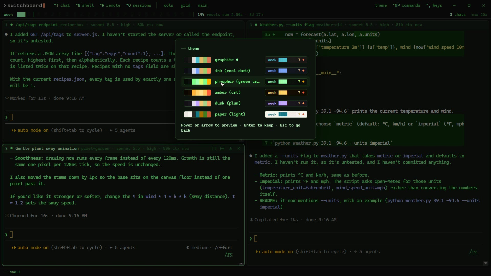
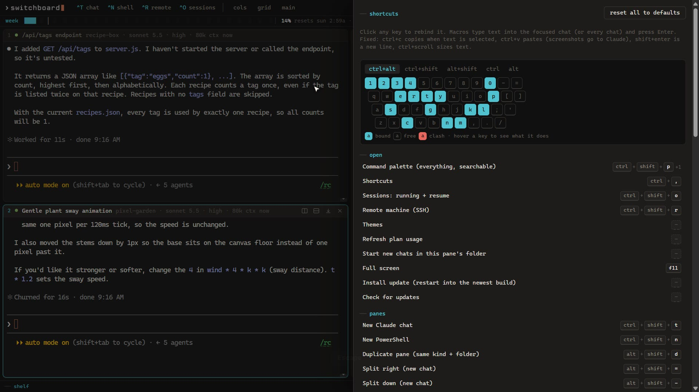

<p align="center"></p>

<p align="center"><b>Your chats, organized.</b><br>
A tiling terminal for Windows and macOS that runs all your Claude Code chats side by side and lights up the one that's waiting on you.</p>

<p align="center">
  <a href="https://github.com/dexterlabs1/switchboard/releases/latest"><b>Download for Windows or Mac</b></a> &nbsp;·&nbsp;
  <a href="https://dexterbrewer.com/tools/switchboard"><b>Watch the demo</b></a> &nbsp;·&nbsp;
  MIT licensed, free
</p>

<p align="center"><a href="https://dexterbrewer.com/tools/switchboard"></a></p>

## Why
Running three or four Claude Code chats in terminal tabs means clicking through every tab to find out which
one finished, which one is still working and which one has been waiting on a question for ten minutes.
Switchboard puts them all on one screen and tells you.

## What it does
- **It knows what each chat is doing.** Every pane shows working, idle or **needs you**. When a chat finishes
  or asks something while you're elsewhere, its lamp lights, the title bar counts it and the taskbar flashes.
  `Ctrl+Shift+Space` jumps to the next one. Nothing to configure: it reads Claude Code's own session files, so no hooks or settings.
- **Tile it your way.** Drag a pane's header onto an edge to dock it, or onto another pane to swap. Drag the
  dividers; double-click one to even things out. Columns, grid and main + stack layouts are one click away.
- **The header tells you the rest.** The chat's title, model and effort, context used, which repo it's
  working in, and how long since it last changed. Double-click the name to rename it.
- **Ctrl + scroll** zooms one pane; Ctrl + Shift + scroll zooms all of them.
- **A shelf for later.** Park a chat in the bottom bar (`Ctrl+Shift+S`): a busy one keeps running off-screen,
  an idle one closes and resumes when you bring it back. Chips are grouped by project, show Claude's last
  reply on hover, and take a note or a reminder. The space it leaves offers *new chat* or *fill space*.
- **Picks up where you left off.** Close it and reopen it: the layout comes back and every chat resumes.
- **Your plan usage in view.** Session and weekly meters in an ASCII status line, the same numbers as `/usage`.
- **Keyboard first.** A command palette (`Ctrl+Shift+P`), a keyboard map where every shortcut can be
  rebound, and macros that type your most common replies or slash commands into one chat or all of them.
- **Other machines too.** Open a shell or a Claude chat over SSH, using hosts from `~/.ssh/config` and
  your Tailscale peers.
- **Paste works.** `Ctrl+C` copies when text is selected and interrupts when not. Pasting a screenshot hands it
  to Claude as an image; dropping files types their paths.
- **Six themes**, previewed live: graphite, ink, phosphor, amber, dusk and paper.
- **Updates itself.** A new release shows an update button with its notes; one click installs it and your chats come back.

<p align="center">
  
  
  
  
</p>

## Install
You need [Claude Code](https://docs.claude.com/en/docs/claude-code) installed and signed in. Switchboard looks for it in
`~/.local/bin/claude` (`claude.exe` on Windows), then on your `PATH`.

**Windows** (10 and 11, x64)
1. Download `Switchboard_x.y.z_x64-setup.exe` from the [latest release](https://github.com/dexterlabs1/switchboard/releases/latest)
   and run it. It installs for your user only; no admin needed.
2. The installer isn't code-signed yet, so Windows SmartScreen may warn you: click **More info → Run anyway**.

**macOS** (11 Big Sur or later, Apple Silicon and Intel)
1. Download `Switchboard_x.y.z_universal.dmg` from the [latest release](https://github.com/dexterlabs1/switchboard/releases/latest),
   open it and drag Switchboard into Applications.
2. The app isn't signed with an Apple developer ID yet, so the first launch needs one extra step:
   **right-click Switchboard in Applications → Open → Open**. On macOS 15 and later, if there's no Open button,
   go to **System Settings → Privacy & Security** and click **Open Anyway**. After that it opens normally.
3. Shortcuts use **⌘** where Windows uses Ctrl (⌘T new chat, ⌘W close, ⌘1…9, ⇧⌘P palette, ⌘, shortcuts);
   **⌃** keys go to the terminal as usual, so ⌃C interrupts and ⌃V pastes a screenshot into Claude.
   Panes run your login shell (`$SHELL`, usually zsh).

A new chat opens in your home folder; use *Start new chats in this pane's folder* from the palette to change
that, or start one anywhere from a script:

```
switchboard.exe --new-claude --cwd C:\path\to\project     # opens a chat in the running window
switchboard.exe --new-claude --continue --cwd ...          # resumes the latest chat in that folder
switchboard.exe --shell --cwd ...

# macOS: the same flags on the app's binary
/Applications/Switchboard.app/Contents/MacOS/switchboard --new-claude --cwd ~/code/project
```

## Straight answers
- **Is it official?** No. It's an independent tool built on top of Claude Code.
- **How does it know a chat's status?** Claude Code keeps a small file per running session in
  `~/.claude/sessions`; Switchboard matches those to its panes. That format isn't documented, so a Claude Code update
  could break the lamps until Switchboard catches up. The terminals keep working either way.
- **What about my login?** The usage meter calls the same endpoint as `/usage`, with the sign-in Claude Code already
  stores (on a Mac, Claude Code keeps it in your login Keychain, and Switchboard reads it from there). The token is only
  ever sent to `api.anthropic.com`. Nothing else leaves your machine.
- **macOS?** Yes, see Install above. Updates work the same way: the app offers them itself.
- **Linux?** Not yet.

## Building from source
Needs Node 20+, Rust (stable) and the [Tauri 2 prerequisites](https://tauri.app/start/prerequisites/) for your OS
(on a Mac: the Xcode command line tools).

```
npm install
npm run app:dev          # dev build, runs beside an installed copy with its own settings
npm run tauri build      # Windows: installer in src-tauri/target/release/bundle/nsis

# macOS, universal binary: .app and .dmg in src-tauri/target/universal-apple-darwin/release/bundle
rustup target add aarch64-apple-darwin x86_64-apple-darwin
npm run tauri build -- --target universal-apple-darwin
```

Architecture notes are in [CLAUDE.md](CLAUDE.md), and traps already hit in [docs/gotchas.md](docs/gotchas.md).
Release notes: [CHANGELOG.md](CHANGELOG.md).

## License
[MIT](LICENSE) © 2026 Dexter Brewer. The Windows build bundles Microsoft's ConPTY (`conpty.dll`, `OpenConsole.exe`; MIT), fetched at build time by `tools/fetch-conpty.mjs`.
